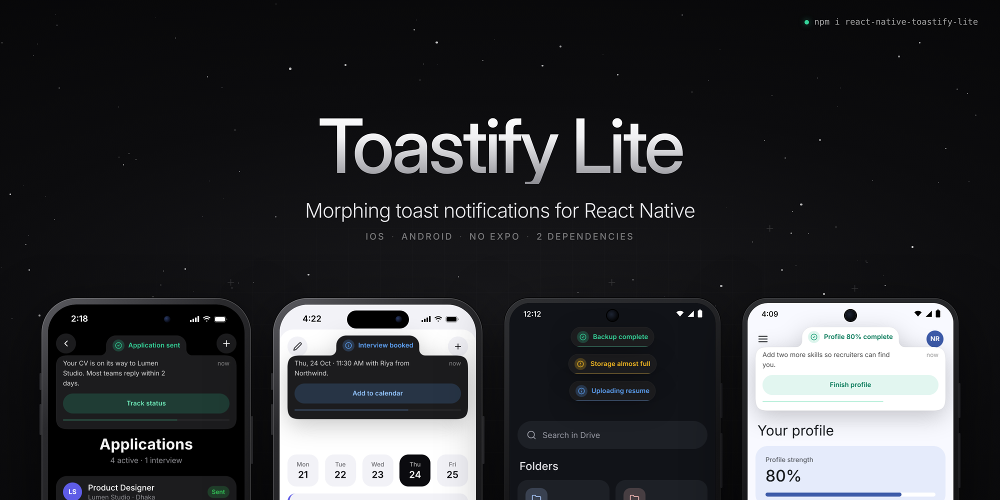
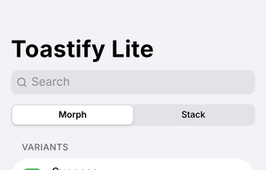
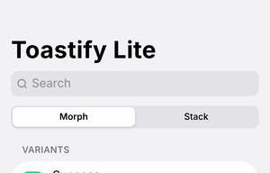
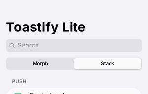
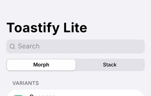
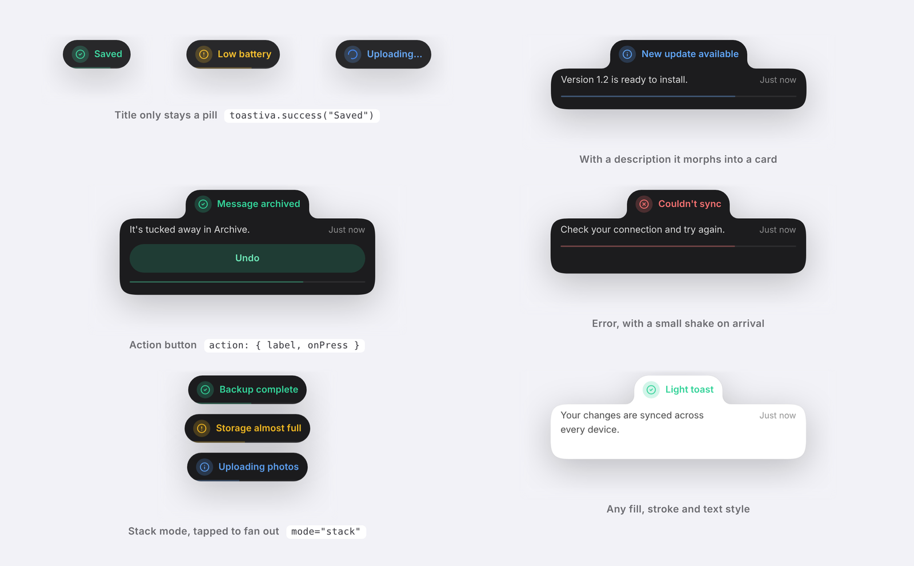

<div align="center">



# react-native-toastify-lite

**Morphing, physics-based toast notifications for React Native.**<br />
A pill that springs open into a card. iOS and Android. No Expo needed.

[](https://www.npmjs.com/package/react-native-toastify-lite)
[](https://www.npmjs.com/package/react-native-toastify-lite)
[](./LICENSE)
[](./docs/api-reference.md#compatibility)
[](./docs/api-reference.md#exports)
[](https://bundlephobia.com/package/react-native-toastify-lite)



</div>

---

## Why this one

- **It morphs.** A short message stays a small pill. Add a description or a button and the pill
  grows a card underneath it, with smooth joined corners, on a physics spring. A new toast morphs
  out of the old one instead of popping in.
- **Light.** Two dependencies you probably already have: `react-native-reanimated` and
  `react-native-svg`. No Expo, no gesture library, no blur library.
- **Complete.** Five tones, primary and secondary actions, promise toasts, live updates, custom
  header and body, six positions, stack and morph modes, swipe to dismiss, duplicate grouping,
  progress bar, timestamps, four motion presets, light/dark + automatic theming, reduced-motion
  support, screen-reader announcements, TypeScript types.
- **Smooth.** Every frame of the shape is computed on the UI thread with Reanimated worklets.

---

## Documentation

| Guide | Description |
| --- | --- |
| 📦 **[Installation](./docs/installation.md)** | Install, Babel plugin, Expo, safe area, troubleshooting. |
| 🚀 **[Usage](./docs/usage.md)** | Setup, the `toast` API, and every recipe. |
| 🎨 **[Styling](./docs/styling.md)** | Theming, colors, shape, per-part style overrides. |
| ✨ **[Animations](./docs/animations.md)** | Presets, springs, timing, reduced motion. |
| 📚 **[API reference](./docs/api-reference.md)** | Every option, prop, and export, in tables. |

---

## Quick start

```bash
npm install react-native-toastify-lite react-native-reanimated react-native-svg
```

```tsx
import { SafeAreaProvider } from 'react-native-safe-area-context';
import { ToastProvider, toast } from 'react-native-toastify-lite';

export default function App() {
  return (
    <SafeAreaProvider>
      <ToastProvider position="top-center" mode="morph">
        <RootNavigator />
      </ToastProvider>
    </SafeAreaProvider>
  );
}

// anywhere, even outside React
toast.success('Saved', { description: 'Your changes are ready.' });
```

Full setup (Babel plugin, Expo, iOS pods) is in [Installation](./docs/installation.md).

---

## Demo

<table>
  <tr>
    <td align="center"><b>Android</b></td>
    <td align="center"><b>iOS</b></td>
  </tr>
  <tr>
    <td align="center">
      
    </td>
    <td align="center">
      
    </td>
  </tr>
</table>

> Press play to watch. If no player shows here, GitHub has stripped the inline `<video>` tag —
> open the file instead: [Android](assets/android.mp4) · [iOS](assets/ios.mp4).

| Promise toasts | Stack mode | Swipe to dismiss |
| :---: | :---: | :---: |
|  |  |  |



More GIFs (variants, custom content, presets, shapes, positions) live in the [example app](./example).

---

## Inspire

Layout inspired by [Sileo](https://sileo.aaryan.design).

## License

[MIT](./LICENSE)
