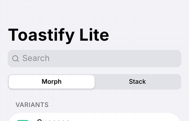
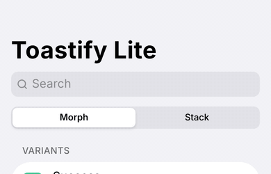
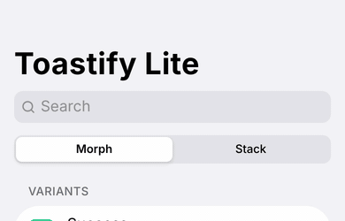
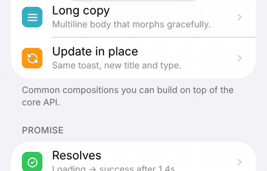
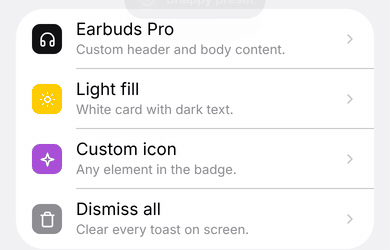
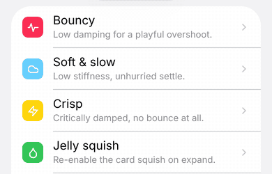
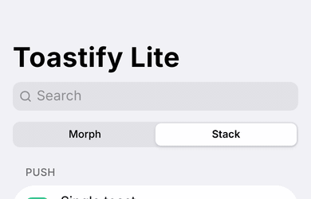
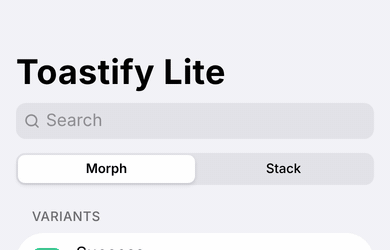
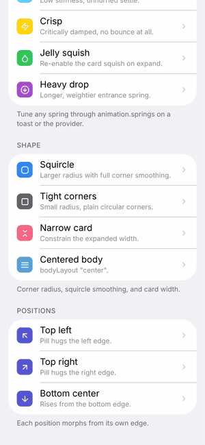

# Toastify Lite example

A plain **React Native CLI** app (no Expo) that shows every feature of
`react-native-toastify-lite`. It looks like an iOS Settings list: tap a row to fire a toast.



## Run it

You need a normal React Native setup (Xcode for iOS, Android Studio + SDK for Android).
See https://reactnative.dev/docs/set-up-your-environment.

```bash
cd example
npm install

# iOS
cd ios && bundle install && bundle exec pod install && cd ..
npm run ios

# Android
npm run android
```

Metro loads the library straight from `../src`, so you can edit the library and see changes live.

Dependencies of this app: `react-native`, `react-native-reanimated`, `react-native-worklets`,
`react-native-svg`, `react-native-safe-area-context`. Nothing from Expo.

## Examples

Each topic is one small file in [`src/examples`](src/examples). Open the file to copy the snippet.

| File | What it shows | GIF |
| --- | --- | --- |
| [`01-variants.tsx`](src/examples/01-variants.tsx) | success, error, info, warning, default | [variants.gif](gifs/variants.gif) |
| [`02-patterns.tsx`](src/examples/02-patterns.tsx) | action button, title only, long text, `update()` in place | [action.gif](gifs/action.gif) |
| [`03-promise.tsx`](src/examples/03-promise.tsx) | `toast.promise` resolve and reject | [promise.gif](gifs/promise.gif) |
| [`04-custom.tsx`](src/examples/04-custom.tsx) | custom header + body, light fill, custom icon | [custom.gif](gifs/custom.gif) |
| [`05-animation.tsx`](src/examples/05-animation.tsx) | presets (smooth, snappy, gentle, minimal) and custom springs | [presets.gif](gifs/presets.gif) |
| [`06-shape-position.tsx`](src/examples/06-shape-position.tsx) | squircle, radius, width, all positions | [shape.gif](gifs/shape.gif), [positions.gif](gifs/positions.gif) |
| [`07-stack.tsx`](src/examples/07-stack.tsx) | stack mode: pile, fan out, bodies | [stack.gif](gifs/stack.gif) |
| (any toast) | swipe up / sideways to dismiss | [swipe.gif](gifs/swipe.gif) |

## GIFs

| | |
| --- | --- |
| **Variants**<br> | **Action + update**<br> |
| **Promise**<br> | **Custom**<br> |
| **Presets + springs**<br> | **Shape**<br> |
| **Stack mode**<br> | **Swipe to dismiss**<br> |
| **Positions**<br> | |

The GIFs were recorded from this exact app code rendered in Chromium (react-native-web) at
iPhone size, frame by frame at 30 fps. On a device the motion is the same; fonts are the
platform's system font.

## Minimal setup in your own app

```tsx
import { SafeAreaProvider } from 'react-native-safe-area-context';
import { ToastProvider, toast } from 'react-native-toastify-lite';

export default function App() {
  return (
    <SafeAreaProvider>
      <ToastProvider mode="morph">
        <YourApp />
      </ToastProvider>
    </SafeAreaProvider>
  );
}

toast.success('Saved', { description: 'Your changes are ready.' });
```

`babel.config.js` must end with the Reanimated plugin:

```js
module.exports = {
  presets: ['module:@react-native/babel-preset'],
  plugins: ['react-native-worklets/plugin'], // Reanimated 3: 'react-native-reanimated/plugin'
};
```
